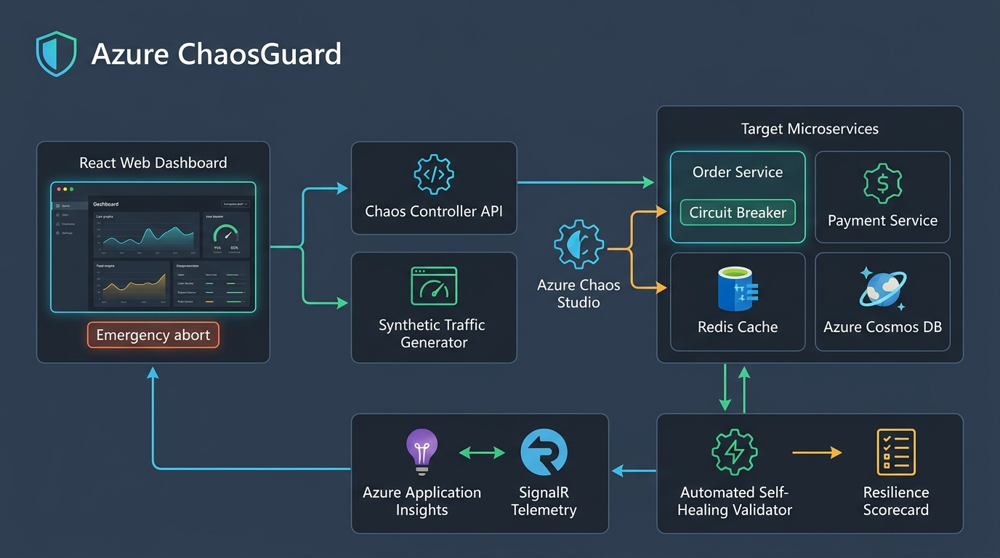

# Azure ChaosGuard: Enterprise Resilience & Self-Healing Validator

> **Next-Generation Cloud Resilience, Automated Chaos Engineering & FinOps Platform for Microsoft Azure**

[](https://www.python.org/)
[](https://fastapi.tiangolo.com/)
[](https://azure.microsoft.com/)
[](.github/workflows/resilience-gate.yml)
[]()
[](LICENSE)

---

## 🌐 Architecture & Workflow Overview

**Azure ChaosGuard** is an enterprise-grade cloud resilience engineering and self-healing validation platform. Beyond conventional chaos testing, it unifies **Python FastAPI microservices**, **circuit breaker state machines**, **real-time WebSocket telemetry**, **FinOps cloud cost analytics**, **Azure Front Door multi-region failover**, and **automated CI/CD PR gating** into a single cohesive system.


---

## 🖥️ Live Operations Console

The clean, non-technical multi-page web dashboard connects over WebSockets to monitor customer order wait times, throughput, automated safety shield triggers, and cloud spend in real time.


---

## 🏗️ Master Cloud Architecture



---

## ✨ Key Features & Capabilities

### 1. 💰 Cloud Cost Analyzer (FinOps)
* **Which Service Costs More? (Ranked):** Live ranking and percentage breakdown of cloud consumption:
  * **#1: 🗄️ Azure Cosmos DB (~47%):** Highest cost service due to dynamic Serverless Request Units (RU/s) scaling during burst traffic.
  * **#2: 📦 Azure Container Apps (~30%):** Autoscales vCPU cores and memory replicas to handle load surges.
  * **#3: ⚡ Azure Cache for Redis (~15%):** Flat-rate high-speed fallback cache tier.
  * **#4: 📡 SignalR & App Insights (~8%):** Log ingestion and streaming telemetry.
* **Interactive Doughnut Breakdown:** Slice-by-slice visual cost distribution powered by Chart.js.
* **Shield Savings Tracker:** Quantifies dollars saved when the Safety Shield diverts traffic from expensive Cosmos DB retries to cheap Redis fallback cache.
* **Budget Guardrail:** Enforces a hard spending cap (default `$2.00 max`) that automatically halts tests before runaway billing can occur.

### 2. 🌍 Global Multi-Region Traffic Splitting Visualizer (Azure Front Door)
* **Active-Active Routing Gauge:** Real-time visual progress bar showing traffic distribution between **East US (Virginia - Primary)** and **West US (California - Standby)**.
* **Sub-2s Disaster Failover:** When an East US data center blackout is injected:
  * East US health probes fail (`503 CONNECTION_TIMED_OUT`).
  * Azure Front Door dynamically shifts **100% of global user traffic to West US** in $< 1.8\text{ seconds}$ with **0 dropped sessions**.
  * Auto-heals and reverts traffic back to East US once the region recovers.

### 3. 🧪 6 Real-World Failure Scenarios
1. **Database Overload (Cosmos DB 429 Storm):** Simulates thousands of buyers rushing in at once, causing the database to hit rate limits.
2. **Slow Server Network Delay (Brownout):** Adds a 1-second delay to downstream payment processing to verify timeout protection.
3. **Server Sudden Crash (Pod Crash):** Turns off an active cloud container instance to verify container replica failover without dropped orders.
4. **Corrupted Data Error Storm (Poison Pill):** Injects bad payloads triggering 500 errors to test dead-letter quarantine queues.
5. **Data Center Outage (Multi-Region Failover):** Simulates primary East US region shutting down to verify automatic Azure Front Door switch to West US.
6. **Cascading Timeout Domino:** Simulates an unresponsive third-party partner freezing for 5 seconds without erroring, validating thread pool isolation and fast-fail timeouts.

### 4. 🏆 "GameDay" SRE Team Simulator (Fire Drill)
* **Surprise Fault Injection:** Injects a random, undisclosed failure into the running system.
* **Live Stopwatch Timer:** Measures **MTTD (Mean Time to Detect)** and **MTTM (Mean Time to Mitigate)**.
* **Readiness Leaderboard:** Live interactive scoreboard ranking engineering response times and operational readiness.

### 5. 🤖 Automated AI Code Fixes & 0–100 Resilience Scorecard
* **4-Pillar Evaluation:**
  * Damage Prevention (Did buyers notice?) — Max 40 pts
  * Speed Retention (Did website stay fast?) — Max 30 pts
  * Self-Healing Speed (How fast did it recover?) — Max 20 pts
  * Error Isolation (Did failures cascade?) — Max 10 pts
* **Automated Git Diff Generation:** AI synthesizes failure logs and outputs an exact GitHub Pull Request patch tuning circuit breaker thresholds and Redis fallback policies.

### 6. 🛡️ Automated CI/CD Chaos Gating Pipeline
* [`.github/workflows/resilience-gate.yml`](.github/workflows/resilience-gate.yml) spins up the Python services on every Pull Request, executes a 20-second chaos experiment, and **automatically blocks merges** if the composite resilience score drops below $80\%$.

### 7. 🔌 Flexible Azure Cloud Account Connector
* Runs in **Safe Local Simulation Mode** out-of-the-box (zero cloud costs, realistic metrics).
* Ready to connect to your live Microsoft Azure subscription whenever you want using 1-click `az login` or [`.env.azure`](.env.azure).

---

## 📂 Repository File Structure

```
azure-chaosguard/
├── assets/                                 # High-resolution architectural diagrams & mockups
│   ├── chaos_master_workflow_diagram.jpg   # End-to-end workflow sequence
│   ├── chaos_architecture_diagram.jpg      # Full Azure cloud infrastructure architecture
│   └── chaosguard_dashboard_mockup.jpg     # Multi-page dark-mode web console
├── backend_python/                         # Python FastAPI Microservices & Chaos Engine
│   ├── run_all.py                          # Master multi-process runner for all Python services
│   ├── order_service.py                    # Orders Gateway with Circuit Breakers (Port 5000)
│   ├── payment_service.py                  # Downstream Payment Service with Fault Hooks (Port 5001)
│   ├── circuit_breaker.py                  # State machine (CLOSED -> OPEN -> HALF-OPEN) + Redis cache
│   ├── chaos_engine.py                     # Chaos Controller API, CostAnalyzer, WebSocket (Port 4000)
│   ├── azure_connector.py                  # Azure cloud authentication & diagnostic module
│   └── requirements.txt                    # Python dependencies (FastAPI, Uvicorn, HTTPX, etc.)
├── apps/
│   └── dashboard/                          # Clean, Multi-Page Web Dashboard
│       ├── public/
│       │   ├── index.html                  # 5-page SPA (Overview, Tests, Drills, Cost, AI)
│       │   ├── styles.css                  # Modern dark-mode UI design system & FinOps charts
│       │   └── app.js                      # WebSocket client, Chart.js graphs, multi-region routing
│       └── server.js                       # Lightweight Node static file server (Port 3000)
├── infra/                                  # Infrastructure as Code (Azure Bicep)
│   └── main.bicep                          # Provisions Cosmos DB, Container Apps, Redis, SignalR
├── .github/
│   └── workflows/
│       └── resilience-gate.yml             # Automated CI/CD chaos quality gate for GitHub Actions
├── .env.azure                              # Azure account connection configuration template
├── connect_azure.ps1                       # Windows PowerShell Azure connection wizard
├── AZURE_ACCOUNT_CONNECTION_GUIDE.md       # Step-by-step instructions for connecting Azure accounts
└── README.md                               # Project documentation
```

---

## 🚀 Quick Start (Running Locally)

### Prerequisites
* **Python 3.10+** (Python 3.11 recommended)
* **Node.js 18+** (for serving the dashboard)

---

### Step 1: Install Python Dependencies
```bash
pip install -r backend_python/requirements.txt
```

### Step 2: Start All Python Microservices
Run the multi-service launcher:
```bash
python backend_python/run_all.py
```
This automatically starts:
* 📦 **Order Service:** [http://localhost:5000](http://localhost:5000)
* 💳 **Payment Service:** [http://localhost:5001](http://localhost:5001)
* 🎮 **Chaos Controller API:** [http://localhost:4000](http://localhost:4000)
* 📡 **WebSocket Telemetry Stream:** `ws://localhost:4000`

### Step 3: Start the Web Dashboard
In a separate terminal:
```bash
cd apps/dashboard
node server.js
```
Open your browser and navigate to:
👉 **[http://localhost:3000](http://localhost:3000)**

---

## 🖥️ Exploring the 5 Dashboard Pages

| Page | Path | What You Can Do |
| :--- | :--- | :--- |
| **1. Live System Overview** | `#overview` | Live order wait times ($p50, p95, p99$), throughput graph, Safety Shield status badge, and the **Global Multi-Region Traffic Splitting Visualizer**. |
| **2. Stress Testing Center** | `#tests` | Choose from **6 failure scenarios**, configure traffic speed (RPS) and duration, and launch tests with live activity logs and Emergency Stop. |
| **3. Team Fire Drill** | `#drills` | Start a surprise mystery failure, race against the live timer to spot and fix the issue, and view team MTTD/MTTM on the leaderboard. |
| **4. Cloud Cost Analyzer** | `#cost` | Real-time FinOps breakdown of **which service costs more**, doughnut percentage chart, budget burn rate, and shield dollar savings. |
| **5. AI Code Fixes & Score** | `#ai` | Full 0 to 100 system resilience scorecard, 4-pillar progress bars, and AI-generated GitHub Pull Request diff code patches. |

---

## ☁️ Connecting Your Microsoft Azure Account

Azure ChaosGuard runs in **Safe Local Simulation Mode** by default. Whenever you are ready to connect your real Azure account:

### Option A: 1-Click Azure CLI (Easiest)
```bash
az login
```
Run the connection verification script:
```powershell
.\connect_azure.ps1
# or: python backend_python/azure_connector.py
```

### Option B: Fill in [`.env.azure`](.env.azure)
Open [`.env.azure`](.env.azure) and enter your credentials:
```ini
AZURE_SUBSCRIPTION_ID=your-subscription-id
AZURE_TENANT_ID=your-tenant-id
AZURE_CLIENT_ID=your-client-id
AZURE_CLIENT_SECRET=your-client-secret
AZURE_RESOURCE_GROUP=rg-chaosguard-prod
```
For complete details, see [AZURE_ACCOUNT_CONNECTION_GUIDE.md](AZURE_ACCOUNT_CONNECTION_GUIDE.md).

---

## 🧪 Automated CI/CD Testing (GitHub Actions)

Every Pull Request automatically triggers the resilience gating pipeline:
```bash
# 1. Spins up Python services on Ubuntu runner
python backend_python/run_all.py &

# 2. Injects a 20-second Cosmos DB 429 storm
curl -X POST http://localhost:4000/api/experiments/start -d '{"scenarioId":"cosmos_429","rps":15,"durationSec":20}'

# 3. Validates resilience score
if score >= 80%: MERGE PASSED ✅
else: MERGE BLOCKED ❌
```

---

## 📄 License

Distributed under the MIT License. See `LICENSE` for more information.
