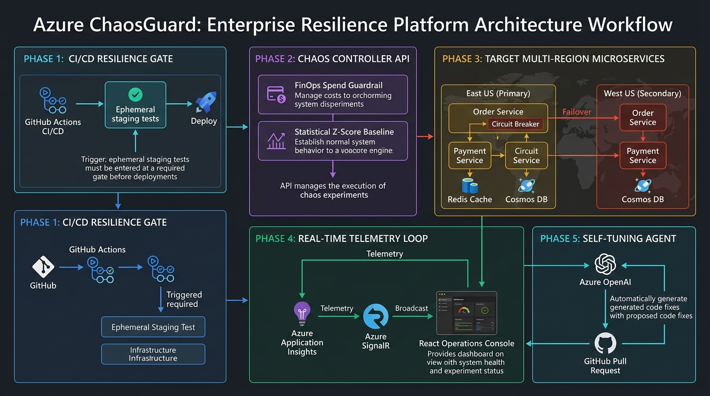
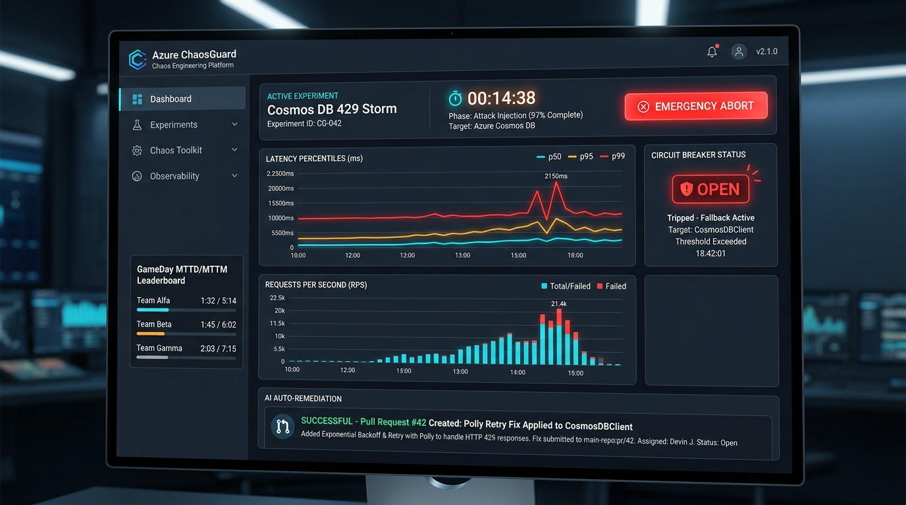

# Azure ChaosGuard: Enterprise Resilience & Self-Healing Validator

> **Production-Grade Chaos Engineering & Automated Self-Healing Platform for Microsoft Azure**



---

## 🚀 Overview

**Azure ChaosGuard** is a cloud resilience engineering platform designed for distributed systems. Beyond standard chaos testing, it unifies **controlled fault injection**, **sub-second telemetry streaming**, **AI-driven root-cause remediation**, **CI/CD quality gating**, **multi-region disaster recovery verification**, and **cost-governed blast radius protection** into a single cohesive system.

---

## 🖥️ Live Operations Console

The real-time operations dashboard connects over WebSockets to monitor distributed transactions, latency percentiles, and circuit breaker transitions as faults are introduced.



---

## 🌟 The 6 Master Innovations

1. **🛡️ CI/CD Resilience Gating (`.github/workflows/resilience-gate.yml`):** Automatically executes a headless chaos test on Pull Requests and blocks merging if resilience score $< 80\%$.
2. **🤖 AI-Powered "Self-Tuning" Auto-Remediation:** Azure OpenAI inspects failure traces and automatically generates a GitHub Pull Request with the exact code and Bicep fix.
3. **🌐 Multi-Region Disaster Recovery Validator:** Simulates total region blackout and verifies Azure Front Door traffic shifting in $< 3\text{s}$.
4. **💰 FinOps Cost-Aware Blast Radius Guardrail:** Enforces a hard budget ceiling (e.g. $\$2.00$ per experiment) to prevent runaway cloud autoscaling bills.
5. **🏆 "GameDay" SRE Team Simulator Mode:** Injects mystery faults, alerts on-call teams, and tracks team MTTD/MTTM on a live leaderboard.
6. **📈 Dynamic Baseline Steady-State Detection:** Uses statistical Z-scores ($\mu \pm 3\sigma$) to eliminate false alarms across varying traffic loads.

---

## 📂 Repository Layout

```
first-antigravity/
├── assets/                         # High-res architecture diagrams & UI mockups
├── apps/
│   ├── target-ecommerce/           # E-commerce microservices with Cockatiel circuit breakers
│   │   ├── src/services/           # Order Service (5000) & Payment Service (5001)
│   │   └── src/resilience/         # Circuit Breaker, Retries, and Fallback policies
│   ├── chaos-engine/               # Chaos Controller API & Metrics Engine (Port 4000)
│   │   ├── src/modules/            # Scenarios, FinOps, Z-Score Baseline, AI Evaluator, GameDay
│   │   └── src/server.js           # REST API + WebSocket Broadcaster
│   └── dashboard/                  # React / Dark-Mode Operations Console (Port 3000)
│       └── public/                 # HTML5, Chart.js, styles.css, app.js
├── infra/                          # Infrastructure as Code
│   └── main.bicep                  # Deploys Container Apps, Cosmos DB, Redis, SignalR
└── .github/
    └── workflows/
        └── resilience-gate.yml     # Automated PR Resilience Quality Gate
```

---

## ⚡ Quick Start (Running Locally)

All three services run concurrently and communicate in real time:

### 1. Start Target Microservices (Order & Payment APIs)
```bash
cd apps/target-ecommerce
npm install
npm start
# 💳 Payment Service running at http://localhost:5001
# 📦 Order Service running at http://localhost:5000
```

### 2. Start Chaos Engine Controller
```bash
cd apps/chaos-engine
npm install
npm start
# 🎮 Chaos Controller running at http://localhost:4000
# 📡 Real-time WebSocket at ws://localhost:4000
```

### 3. Start Operations Console Dashboard
```bash
cd apps/dashboard
npm install
npm start
# 🖥️ Open your browser at http://localhost:3000
```

---

## 🧪 Interactive Testing & Scenarios

From the Operations Console at `http://localhost:3000`, you can:
1. **Select Scenarios:**
   - *Cosmos DB 429 Storm:* Simulates Request Unit exhaustion.
   - *The Brownout:* Injects 1000ms latency into downstream payment processing.
   - *Pod Crash & Flapping:* Simulates 503 service downtime.
   - *Service Bus Poison Pill:* Simulates 500 downstream error flood.
   - *Multi-Region Outage:* Simulates primary region failover.
2. **Observe Self-Healing:** Watch the Circuit Breaker badge trip from `CLOSED` $\rightarrow$ `OPEN` $\rightarrow$ `HALF-OPEN` as fallback cached responses take over.
3. **Emergency Abort:** Click the glowing red **EMERGENCY ABORT** button at any time to instantly restore clean infrastructure state.
4. **GameDay Mode:** Click **"Start Mystery Drill"** to train on-call engineers and log response times on the team leaderboard.
5. **AI Auto-Remediation:** View the generated Pull Request patch and Resilience Scorecard upon experiment completion.
